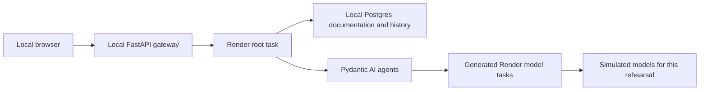

# Rehearse the native Pydantic AI integration

This branch adapts Ask Render Anything so Pydantic AI sends its model requests
to Render Workflows automatically. For example, if the answer model fails once,
Render retries that model request while the completed document search stays done.
A separately scheduled unit of work is called a **task**.

The fork is `ojusave/pydantic-agents-workflows`. The migration lives on branch `pydantic-native-workflows`. The original
team-owned hosted demo remains separate from this fork. Work from `/Users/ojusave/Downloads/Samples/pydantic-agents-workflows`.

## What changed



The gateway accepts a question and polls its result. The root prepares prompts,
searches documents, validates results, and saves the answer. The new capability,
`RenderWorkflows`, sends each named agent's model work to generated child tasks.

- [`workflows/runtime.py`](workflows/runtime.py) shares one task registry.
- [`backend/pipeline/_agents.py`](backend/pipeline/_agents.py) attaches a capability
  to each of seven named agents and sets its retry and time limits.
- [`workflows/app.py`](workflows/app.py) calls ordinary pipeline functions instead
  of wrapping each AI stage in a manually defined Render task.
- Token accounting uses the new `result.usage.input_tokens` and
  `result.usage.output_tokens` fields. Empty claim lists now include zero tokens.

Accuracy and the two quality judges run concurrently. Claims are verified in
separate model task runs. Embeddings and database operations stay in the root;
the existing ingestion tasks remain explicit. Root retries are disabled because
a root restart repeats earlier work. This is not whole-function checkpoint recovery.

## Prerequisites

The checked local setup uses Python 3.13.14, uv 0.12.1, Render CLI 2.28.0, Node
24.18.0, and PostgreSQL 17 with pgvector. Python packages are pinned in `uv.lock`:

| Package | Tested version |
|---|---|
| Pydantic AI slim and graph | `2.55.1.dev56+cc317271` |
| Pydantic AI Harness | `0.55.1.dev56+cc317271` |
| Render Python SDK | `1.2.0` |

The [upstream integration](https://github.com/pydantic/pydantic-ai/pull/9439) merged,
but the checked Harness 0.55.0 release did not contain its `render` extra. All three
Pydantic packages therefore use the same exact Git commit,
`cc3172717752395b7475e545338950235533ccb8`, through `tool.uv.sources`.
Use `uv sync --frozen` to install this checked dependency set.

## Run the simulated rehearsal

The app at [localhost:3040](http://localhost:3040) currently uses simulated answers.
The database is isolated at port 55437 with database name `pydantic_demo_test`.
No real model keys are needed. Answers are visibly labeled **SIMULATED LOCAL TEST**;
quality scores and estimated costs are test values, not a real model assessment or bill.

The setup already exists on Ojus's computer. To recreate its environment file,
copy `.env.test.example` to `.env.test.local`, replacing `YOUR_LOCAL_POSTGRES_USER`
with the local account that owns the test database. For a fresh machine, create a
Postgres database with that name on port 55437 and install pgvector first. The
fixture refuses other hosts, ports, or database names.

Run these commands from the repository directory. Keep each server terminal open.

1. Install Python dependencies and seed the two synthetic documentation passages:

   ```sh
   uv sync --frozen
   .venv/bin/python -m tests.local_worker --seed
   ```

   Seeding replaces only the test database's document rows. It does not load the
   real documentation corpus or measure retrieval quality.

2. In one terminal, start the local Render task server:

   ```sh
   render workflows dev --env-file .env.test.local --port 8127 -- .venv/bin/python -m tests.local_worker
   ```

   Success reports 46 registered tasks. A separate terminal can list them with
   `render workflows tasks list --local --port 8127`.

3. In another terminal, start the gateway that accepts browser questions:

   ```sh
   .venv/bin/python -m tests.local_worker --api
   ```

   Success reports that Uvicorn is running at `http://127.0.0.1:8040`.

4. Build and serve the frontend in a third terminal:

   ```sh
   npm ci --prefix frontend
   NEXT_PUBLIC_API_URL=http://127.0.0.1:8040 npm run build --prefix frontend
   .venv/bin/python -m http.server 3040 --bind 127.0.0.1 --directory frontend/out
   ```

   Open [the local app](http://localhost:3040) and ask:
   “What web service deployment options does Render offer?” A completed result
   has a simulated answer, two sources, two claims, and seven pipeline stages.

## Verified on October 13, 2026

Run `.venv/bin/python -m tests.test_local_integration` in another terminal.
Four checks passed through the real gateway, local Render transport, and Postgres:

- A completed answer uses eight model worker processes across seven agents,
  saves history, and reports stage progress. The three final reviews overlap.
- One injected answer failure retries only that model request. Query expansion
  runs once, proving the root did not restart.
- An empty claims list completes with zero verification tokens.
- A persistent failure stops after the initial attempt plus three retries and
  reaches the gateway as a failed result.

Both the normal and synthetic worker entrypoints register the same 46 task names.
The frontend production build, Python compilation, dependency-lock check, and
changed Python-file lint passed. Gateway lint preserves its existing exception
for loading environment settings before imports (`E402`). Local run records and
callback evidence are saved under ignored `.local/` for inspection.

Ojus chose simulated testing. Real OpenAI/Anthropic behavior, hosted Render task
execution, hosted Logfire traces, and real documentation-search quality have not
been verified on this branch. The local checks above precede the separately requested Render deployment.

## Stop and resume

Stop the three foreground server commands with Control-C in their terminals.
For this machine's Homebrew Postgres instance, stop only the rehearsal database:

```sh
/opt/homebrew/opt/postgresql@17/bin/pg_ctl -D .local/postgres stop
```

This preserves the database and run evidence. To restart that same database:

```sh
/opt/homebrew/opt/postgresql@17/bin/pg_ctl -D .local/postgres -l .local/postgres.log -o '-p 55437 -h 127.0.0.1 -k /private/tmp' start
```

Then start the three app servers above. Keep `.env.test.local` and `.local/`
out of commits; `.gitignore` already excludes both.


## Hosted simulation

The `workflows.demo` entrypoint runs the same native Render task registry with
fixed model responses and embeddings. It requires `DEMO_MODE=simulated` and a
dedicated database named `pydantic_native_demo_db`. It never needs real model keys.
Use `.venv/bin/python -m workflows.demo` for the workflow service and
`.venv/bin/python -m workflows.demo --api` for the HTTP gateway. The gateway seeds
two example passages once and preserves saved questions on later deployments.

The frontend uses `NEXT_PUBLIC_DEMO_MODE=simulated` and the gateway URL in
`NEXT_PUBLIC_API_URL` at build time. Its `start` command serves the exported `out`
folder on Render's assigned port, using `serve` on a paid Node web service.
The banner and score labels identify synthetic answers and estimates. Render task
execution and database history are real; quality and cost numbers are examples,
not measurements of provider quality or billed charges. Local failure-injection
phrases are disabled in the hosted simulation because cloud workers do not share
local marker files. The regular `workflows.app` entrypoint remains the real-model
path and requires provider credentials.


Hosted verification on October 13, 2026: the native registry contained 46 task
definitions. A direct cloud rehearsal completed one root task and eight model
request tasks across seven agents. All eight were children of the root; the
three review tasks had overlapping execution intervals. The returned answer had
two sources, two claims, and seven logical stages. Saved history was independently
retrieved through the hosted API. Local success, retry, empty-claim, and persistent
failure checks also passed after the shared simulation helper was introduced.
These results verify task execution and application flow with simulated providers.

The static server uses a `compression` override at 1.8.2 because `serve` 14.2.6
pins the affected 1.8.1 release. Next.js generates static files during the build;
`serve` handles public frontend requests.

The public browser flow also completed: submitting a question started the hosted
workflow, displayed progress, returned the simulated answer, and showed corrected
score, cost, and timing labels. The cloud task record independently confirmed the
browser-triggered root completed. No real-provider quality claim follows from it.
